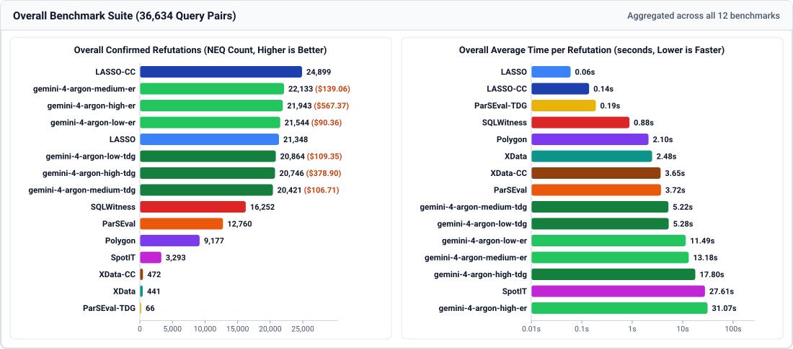

# LASSO: An LLM-Agent Synthesized System for SQL Validation

- **Website:** [https://xdata-lasso.github.io](https://xdata-lasso.github.io) ([Evaluation Results](https://xdata-lasso.github.io/results))
- **arXiv Preprint:** [https://arxiv.org/abs/2610.38294](https://arxiv.org/abs/2610.38294)

This repository contains the official artifact evaluation reproduction package for **LASSO**, a framework for discovering semantic oversights, validating SQL query equivalence, and synthesizing deterministic counterexample datasets to refute incorrect SQL predictions.

<p align="center">
  
</p>

---

## 1. Quick Setup & Usage

### Setup
```bash
chmod +x setup_env.sh
./setup_env.sh
source venv/bin/activate
```

### Example: Dataset Generation & Execution Testing
```python
import sys
sys.path.insert(0, "src")
sys.path.insert(0, "sql-execution-tester")

from main import generate_test_data
from execution_tester import execution_test
from query_normalizer import normalize_sql

schema = "CREATE TABLE staff (id INT PRIMARY KEY, dept TEXT, bonus INT NULL);"
gold_sql = normalize_sql("SELECT dept, COUNT(*) FROM staff GROUP BY dept;", schema)
pred_sql = normalize_sql("SELECT dept, COUNT(bonus) FROM staff GROUP BY dept;", schema)

# 1. Generate test datasets from schema and query
datasets = generate_test_data(schema, gold_sql)

# 2. Execute and compare reference vs. candidate query on generated datasets
for ds in datasets:
    res = execution_test(
        schema=schema,
        dataset="\n".join(ds.insert_statements),
        gold_sql=gold_sql,
        prediction_sql=pred_sql,
        dialect="sqlite",
    )
    if res["status"].startswith("NEQ"):
        print(f"Refuted by {ds.strategy_name}: {res['reason']}")
        break
```

### `generate_test_data(ddl_string, query_string, seed=42)` ([`src/main.py`](src/main.py))

| Parameter / Output Field | Type | Description |
| :--- | :--- | :--- |
| `ddl_string` (Input) | `str` | SQL `CREATE TABLE` DDL statements defining tables and constraints. |
| `query_string` (Input) | `str` | Target SQL `SELECT` query. |
| `seed` (Input) | `int` | Deterministic seed (default `42`). |
| `Dataset.strategy_name` (Output) | `str` | Attack strategy name (e.g., `BaseDatasetStrategy`, `JoinAttackStrategy`). |
| `Dataset.insert_statements` (Output) | `list[str]` | Synthesized `INSERT INTO ...` SQL statements. |
| `Dataset.data` (Output) | `dict` | Table-to-rows dictionary (`{table: [{col: val}, ...]}`). |
| `Dataset.description` (Output) | `str` | Target semantic bug or edge case description. |

### `execution_test(schema, dataset, gold_sql, prediction_sql, dialect="sqlite", ...)` ([`sql-execution-tester/execution_tester.py`](sql-execution-tester/execution_tester.py))

| Parameter / Output Field | Type | Description |
| :--- | :--- | :--- |
| `schema` (Input) | `str` | SQL `CREATE TABLE` DDL statements. |
| `dataset` (Input) | `str` | SQL `INSERT INTO` statements populating the test database. |
| `gold_sql` / `prediction_sql` (Input) | `str` | Reference and candidate SQL queries to compare. |
| `dialect` (Input) | `str` | `"sqlite"` (default), `"postgres"`, or `"mysql"`. |
| `strict_column_ordering` (Input) | `bool` | Require matching column order (default `True`; returns `NEQ_SCO` if relaxed matches). |
| `allow_extra_columns_in_q2` (Input) | `bool` | Allow extra trailing columns in `prediction_sql` (default `True`). |
| `status` (Output) | `str` | `"EQ_EXEC"`, `"NEQ"`, `"NEQ_SCO"`, or `"ERROR_*"` (`SYNTAX`, `QUERY_EXECUTION`, `SCHEMA_LOADING`, `DATASET_LOADING`). |
| `reason` (Output) | `str` | Discrepancy reason when `NEQ` (e.g., `row_count_mismatch`, `value_mismatch`, `row_order_mismatch`). |
| `gold_sql_result` / `prediction_sql_result` (Output) | `list[tuple]` | Raw output rows from executing each query. |
| `reproducible_cex` (Output) | `str` | Self-contained `.sql` counterexample script (DDL + `INSERT`s + queries + outputs). |

---

## 2. Evaluation Results Website

Evaluation results can be viewed online at **[https://xdata-lasso.github.io/results](https://xdata-lasso.github.io/results)** (project page: **[https://xdata-lasso.github.io](https://xdata-lasso.github.io)**). All aggregated benchmark tables, strategy breakdowns, and token/cost statistics are stored in [`experiments/analysis.txt`](experiments/analysis.txt), [`experiments/analysis_summary.json`](experiments/analysis_summary.json), and [`experiments/strategy_summary.txt`](experiments/strategy_summary.txt) (with per-benchmark CSVs and `.sql` counterexamples in [`experiments/results/`](experiments/results/)).

To serve the results viewer locally (port `8000`):
```bash
source venv/bin/activate
python3 web/server.py
```
Then open [http://localhost:8000/results](http://localhost:8000/results).

---

## 3. Technical Documentation

Extended technical specifications and theoretical foundations are located in [`docs/`](docs/):

1. **[Base Data Generation Pipeline Details (`docs/pipeline_details.md`)](docs/pipeline_details.md)**
2. **[Theoretical Foundations & Academic Lineage (`docs/theoretical_foundations.md`)](docs/theoretical_foundations.md)**
3. **[Agent Scaffolding Prompt & Design Philosophy (`docs/agent_scaffolding.md`)](docs/agent_scaffolding.md)**

---

## 4. Running the LASSO Test Suite

```bash
# Run all test cases (run_all.py)
python3 run_all.py
python3 run_all.py --verbose

# Run a single test case JSON (test_runner.py)
python3 test_runner.py test_cases/join/join_type_mismatch_medium.json --debug
```

---

## 5. Reproducing Benchmark Results

All evaluation scripts, baseline tools, benchmark datasets (12 benchmarks, 36,634 query pairs), and official experimental results are located in [`experiments/`](experiments/) (and [`results/`](results/)).

```bash
cd experiments

# Run full evaluation suite across all tools
./run_all.sh

# Or run individual tools
./run_lasso.sh --benchmark all
./run_llm_er.sh --model gemini-4-argon-high --benchmark all
./run_llm_tdg.sh --model gemini-4-argon-high --benchmark all
./run_sqlwitness.sh --benchmark all
./run_parseval.sh --benchmark all
./run_polygon.sh --benchmark all
./run_spotit.sh --benchmark all
./run_xdata.sh --benchmark xdata
./run_xdatapublic.sh --benchmark xdata
./run_cross_checking_study.sh
```

---

## 6. Official Evaluation Results & Analysis

- **Aggregated Benchmark Tables & Summary:** [`experiments/analysis.txt`](experiments/analysis.txt) and [`experiments/analysis_summary.json`](experiments/analysis_summary.json) (generated by [`experiments/analyze_results.py`](experiments/analyze_results.py)).
- **Attack Strategy Kill Breakdown:** [`experiments/strategy_summary.txt`](experiments/strategy_summary.txt) (generated by [`experiments/summarize_strategy_results.py`](experiments/summarize_strategy_results.py)).
- **Precomputed Benchmark CSVs:** [`experiments/results/`](experiments/results/).
- **Reproducible Counterexamples (`.sql`):** [`experiments/results/reproducible_cex/`](experiments/results/reproducible_cex/) and [`experiments/results/lasso_exclusive/`](experiments/results/lasso_exclusive/).
- **Cross-Checking Study:** [`experiments/results/cross_checking_study/`](experiments/results/cross_checking_study/).
